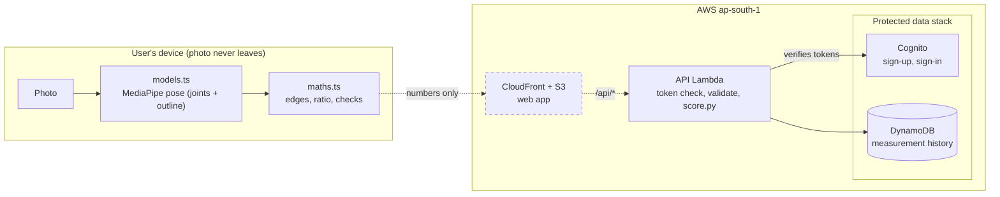
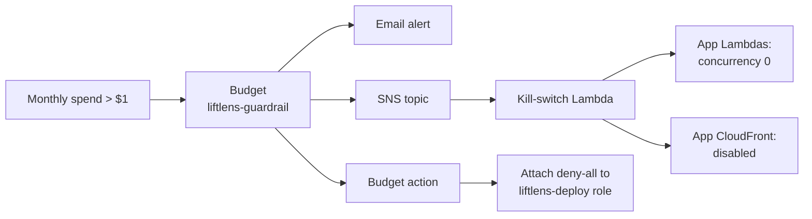

# LiftLens

[](https://github.com/ashutosharma2/LiftLens/actions/workflows/checks.yml)

**Gym-goers can't objectively track physique progress from photos.**

Progress photos are compared by eye, and lighting, camera distance, posture and memory all get in the way. LiftLens turns a front-facing photo into a measurement you can track and check.

It's a serverless SaaS web app on AWS. Pose detection runs on the user's device for privacy, and the backend is Lambda with DynamoDB and Cognito, all managed with Terraform at $0 a month.

**[Read the project story](docs/project-story.md)**: the problems, decisions and fixes behind LiftLens, in SOART format.

## How it works

The measuring happens in your browser. A pose model runs on your own device, finds your joints and body outline, and measures your shoulder and waist widths. The photo is never uploaded ([ADR-002](docs/adr/002-pose-extraction-in-browser.md), [ADR-007](docs/adr/007-pose-model-outline.md)).

LiftLens tracks one number: your shoulder-to-waist ratio, measured edge to edge on your outline. A ratio doesn't depend on how far away the camera was, so photos taken weeks apart stay comparable ([ADR-004](docs/adr/004-scale-free-measurements.md)).

Your first photo shows the ratio. Every later photo shows the percent change since that first one, along with the formula, the inputs and a one-sentence explanation. A change within ±2.4% is reported as noise rather than progress; that band was calibrated from 10 repeat photos ([scoring](docs/scoring.md)). Photos the numbers can't be trusted on, like a sideways shot or arms touching the waist, get a retake with a reason instead of a number ([ADR-008](docs/adr/008-capture-checks-and-pose-matching.md)).

You're only ever compared with yourself. There's no "ideal body" and no comparison with other users. Running it costs $0 a month, and automatic guardrails stop the app if that ever changes.

## Status

| Milestone | | |
|---|---|---|
| M0 Guardrails | ✅ | Budget alerts, budget action, kill switch, deployed and tested |
| M1 Measurement engine | ✅ | Browser measurement (TypeScript) matching the Python prototype; scoring module |
| M2 Auth, API, data | ✅ | Cognito sign-up, DynamoDB, measurements API live and smoke-tested |
| M3 Frontend | ✅ | Sign-in, guided capture, measuring on the device, save, history with trend; noise band calibrated and photo checks added |
| M4 Deploy | ⏳ | Next, after confirming the waist height on fresh photos: S3 + CloudFront |
| M5 CI/CD | ⏳ | Tests and checks run on every pull request; plan and apply through OIDC come with M4 |
| M6 Portfolio finish | | Screenshots, cost write-up |

## Architecture

Solid boxes and arrows are built; dashed ones are planned. **[All 15 architecture diagrams](docs/architecture.md)**: containers, components, infrastructure, identity, trust boundaries, sign-in, capture states, the measurement pipeline, saving, scoring, the data model, guardrails and deployment.



The API and data are live and the browser app works locally; hosting it on CloudFront is next (M4). Until then, the local dev server forwards `/api/*` to the Function URL.

### Cost guardrails

A separate Terraform stack that is never destroyed with the app ([infra/README.md](infra/README.md)).



The kill switch finds app resources by tag (`Project=LiftLens`, `Stack=app`), so it never stops itself or touches stored data. Restoring service is a manual step.

## Key decisions

| ADR | Decision | Why |
|---|---|---|
| [001](docs/adr/001-serverless-terraform.md) | Serverless on AWS, managed with Terraform | Always-on servers and databases bill by the hour; Terraform shows exactly what will change before anything is created |
| [002](docs/adr/002-pose-extraction-in-browser.md) | Pose detection runs in the browser | Physique photos are highly sensitive; if LiftLens never receives them there is nothing to leak |
| [003](docs/adr/003-lambda-concurrency-exception.md) | No reserved Lambda concurrency (superseded) | The account's limit of 10 allowed none; now raised, and reservations are set |
| [004](docs/adr/004-scale-free-measurements.md) | Measurements are scale-free | Shoulders and waist are both measured edge to edge, and a photo shows shape, not size, so LiftLens reports ratios instead of centimetres |
| [005](docs/adr/005-store-ingredients-recompute-scores.md) | Store measurement ingredients, recompute scores | Photos are gone after each check-in, so saving the raw numbers lets better formulas apply to the whole history |
| [006](docs/adr/006-protected-data-stack.md) | Protected data stack, DynamoDB inside the free tier | `terraform destroy` on the app must never remove user data or accounts; provisioned capacity is guaranteed $0 and caps cost |
| [007](docs/adr/007-pose-model-outline.md) | Body outline from the pose model; one baseline per method | The video-call segmenter measured furniture as the body in an ordinary room; different methods are different rulers, so scores never mix them |
| [008](docs/adr/008-capture-checks-and-pose-matching.md) | Catch and guide bad photos; match the baseline's pose | Sideways, back, far-away and arms-touching photos gave confident wrong numbers; arm angle moved the ratio more than the noise band |

## Repository layout

| Path | Contents |
|---|---|
| `frontend/` | React + TypeScript + Vite app. `src/measure/` is the measurement engine and photo checks, `src/capture/` the camera and upload, `src/screens/` and `src/history/` the pages |
| `backend/api/` | Measurements API Lambda: token check, validation, DynamoDB, scores ([contract](docs/api.md)) |
| `backend/scoring/` | Explainable scoring (Python) |
| `backend/kill_switch/` | Cost kill-switch Lambda |
| `infra/guardrails/` | Terraform: budget, budget action, deploy role, kill switch (deployed) |
| `infra/data/` | Terraform: measurement table and user pool, deletion-protected (deployed) |
| `infra/app/` | Terraform: API Lambda and Function URL (deployed) |
| `infra/modules/api/` | The API Lambda module used by `infra/app/` |
| `dev/` | Python prototype, the reference-number export for the parity tests, and the calibration scripts (`noise.py`, `compare_waist_rows.py`) |
| `docs/` | [Project story](docs/project-story.md), [ADRs](docs/adr/), [architecture diagrams](docs/architecture.md), [API contract](docs/api.md) and [scoring](docs/scoring.md). The other files there describe the original FastAPI design and are marked superseded |
| `.github/` | The checks workflow and the pull request template |

## Running locally

You need Node 26, Python 3.13 and Terraform 1.16, the same versions the checks use. All commands run from the repo root.

**Tests**

```sh
# Frontend: tests, lint and production build
(cd frontend && npm ci && npm test && npm run lint && npm run build)

# Python: scoring, API and kill switch
python3 -m venv backend/.venv && backend/.venv/bin/pip install pytest boto3 -r backend/api/requirements.txt
for d in scoring api kill_switch; do (cd backend/$d && ../.venv/bin/python -m pytest); done
```

The parity tests compare the TypeScript maths with the Python reference on real photos. Photos are never committed, so those tests skip unless you add your own to `dev/fixtures/` and run `dev/export_fixture.py` (see the script for setup).

The same checks run on GitHub Actions for every pull request and every push to `main` ([checks.yml](.github/workflows/checks.yml)), and a pull request can't be merged until they pass. The workflow has no AWS access.

**The app**

The app signs in against the deployed user pool, and the dev server forwards `/api/*` to the deployed API. Once the data and app stacks exist (see Deploying), write the settings it needs into the gitignored `frontend/.env.local`, then start it:

```sh
AWS_PROFILE=liftlens-deploy frontend/scripts/write-env.sh
(cd frontend && npm run dev)
```

`npm run dev` copies the MediaPipe model files into place first. Open the app in a desktop browser at the address it prints. A phone can't use it over your local network, because the camera and sign-in need a secure (HTTPS) page; that comes with hosting on CloudFront (M4).

## Deploying

Infrastructure is deployed with Terraform from your machine. You sign in through AWS IAM Identity Center, so there are no access keys. Every apply uses a saved plan that has been reviewed first, and nothing deploys from CI yet.

Two AWS CLI profiles are used:

- `liftlens`: your SSO sign-in.
- `liftlens-deploy`: assumes the `liftlens-deploy` role that the guardrails stack creates. It's the role the budget action locks if spending passes $1.

```ini
# ~/.aws/config
[profile liftlens-deploy]
role_arn = arn:aws:iam::<account-id>:role/liftlens-deploy
source_profile = liftlens
region = ap-south-1
```

The guardrails stack is always applied with the SSO profile, so it stays fixable even while the deploy role is locked:

```sh
aws sso login --profile liftlens
echo 'alert_email = "you@example.com"' > infra/guardrails/terraform.tfvars   # gitignored
AWS_PROFILE=liftlens terraform -chdir=infra/guardrails init
AWS_PROFILE=liftlens terraform -chdir=infra/guardrails plan -out=guardrails.tfplan   # review every resource
AWS_PROFILE=liftlens terraform -chdir=infra/guardrails apply guardrails.tfplan
```

The data and app stacks are applied with the deploy role, data first, because the app stack looks up the table and user pool:

```sh
backend/api/build.sh   # package the API for Lambda (Linux arm64)
AWS_PROFILE=liftlens-deploy terraform -chdir=infra/data init
AWS_PROFILE=liftlens-deploy terraform -chdir=infra/data plan -out=data.tfplan
AWS_PROFILE=liftlens-deploy terraform -chdir=infra/data apply data.tfplan
AWS_PROFILE=liftlens-deploy terraform -chdir=infra/app init
AWS_PROFILE=liftlens-deploy terraform -chdir=infra/app plan -out=app.tfplan
AWS_PROFILE=liftlens-deploy terraform -chdir=infra/app apply app.tfplan
```

If an apply fails with "No valid credential sources found", the SSO session has expired: run `aws sso login --profile liftlens` again. More fixes are in [infra/README.md](infra/README.md#troubleshooting).

## Cost

Everything is serverless and billed per use, within AWS's always-free allowances. Nothing bills by the hour. If spend ever passes $1 in a month, the guardrails above stop the app and lock deploys.
