# LiftLens architecture diagrams

## Summary (SOART)

- **Scenario:** LiftLens turns a front-facing photo into a shoulder-to-waist measurement and tracks it over time, on AWS, at $0/month.
- **Obstacle:** the design decisions are spread across six ADRs, the API contract and the scoring spec; there was no single picture of how the pieces fit, and the previous version of this file described an abandoned FastAPI design.
- **Action:** one diagram per view of the system, each drawn from the code and Terraform as they are today. Solid lines and boxes are built; dashed ones are planned.
- **Result:** the whole system can be followed from the photo to the stored number, from sign-up to a saved measurement, and from a $1 bill to a stopped app.
- **Troubleshooting:** the diagrams are only useful while they're accurate, so they're updated at the end of every milestone, alongside the README.

**Contents**

1. [System context](#1-system-context)
2. [Containers](#2-containers)
3. [Browser app components](#3-browser-app-components)
4. [API Lambda components](#4-api-lambda-components)
5. [AWS infrastructure and Terraform stacks](#5-aws-infrastructure-and-terraform-stacks)
6. [Identity and access](#6-identity-and-access)
7. [Trust boundaries](#7-trust-boundaries)
8. [Sign-up and sign-in](#8-sign-up-and-sign-in)
9. [Check-in capture states](#9-check-in-capture-states)
10. [Measurement pipeline](#10-measurement-pipeline)
11. [Saving a measurement](#11-saving-a-measurement)
12. [Scoring decisions](#12-scoring-decisions)
13. [Data model](#13-data-model)
14. [Cost guardrails](#14-cost-guardrails)
15. [Deployment](#15-deployment)

---

## 1. System context

Who and what LiftLens interacts with. The photo never leaves the user's device; only numbers reach AWS.

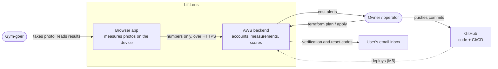

## 2. Containers

The deployable pieces and how they talk. Until CloudFront exists (M4), the local dev server forwards `/api/*` to the Function URL, the same path CloudFront will use.

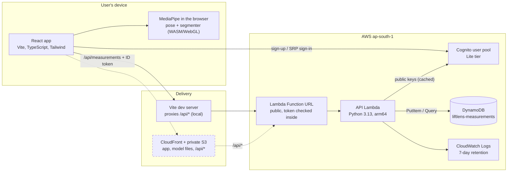

## 3. Browser app components

How the frontend code is organised. Pure modules (unit-tested without a browser) are separate from the ones that talk to the camera, the models or the network.

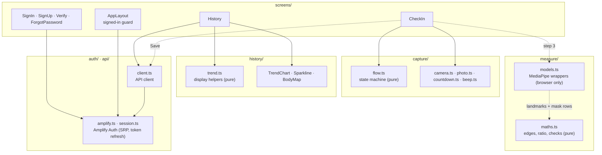

## 4. API Lambda components

One Lambda, split so everything except `store.py` and the key download is pure and tested with fakes.

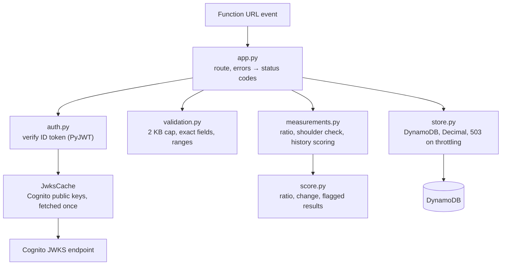

## 5. AWS infrastructure and Terraform stacks

Three Terraform roots with different lifecycles. Destroying `app` can never remove cost protection or user data. Tags let the kill switch find app resources without sharing state.

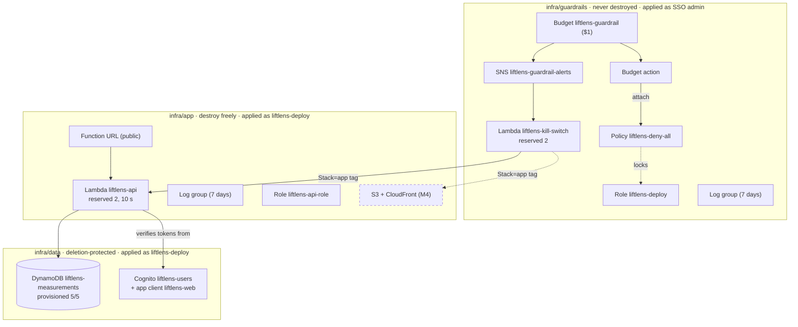

## 6. Identity and access

Who can do what. People sign in with temporary credentials only; every service role is limited to exactly what it needs.

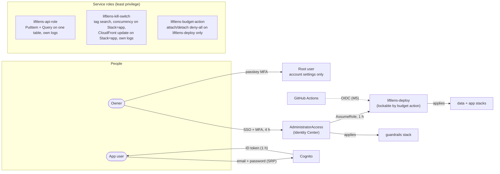

## 7. Trust boundaries

What each side trusts. The server treats every request as possibly edited; the photo never crosses the boundary.

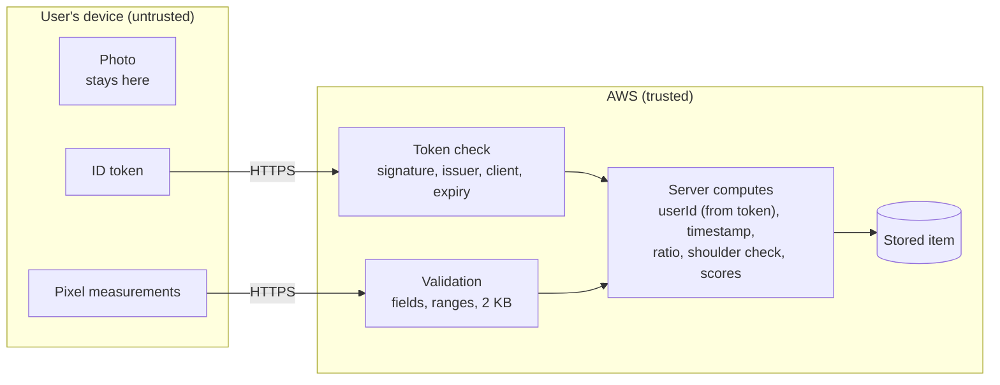

## 8. Sign-up and sign-in

Amplify runs SRP, so the password itself is never sent. Tokens refresh quietly; a 401 sends the user back to sign in.

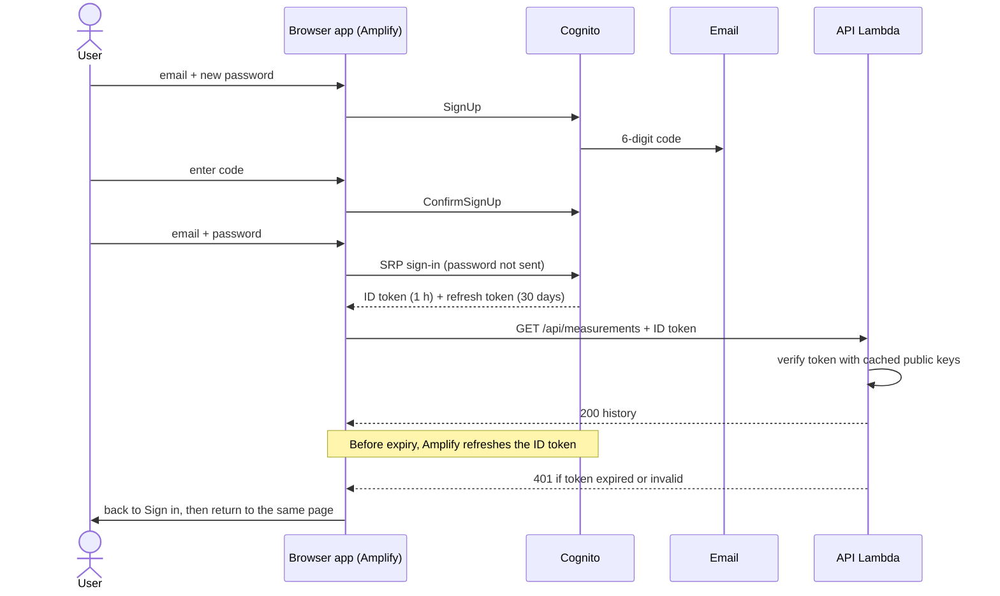

## 9. Check-in capture states

`flow.ts` as a state machine. The camera runs only in `opening`, `live` and `countdown`; leaving them, or the screen, turns it off.

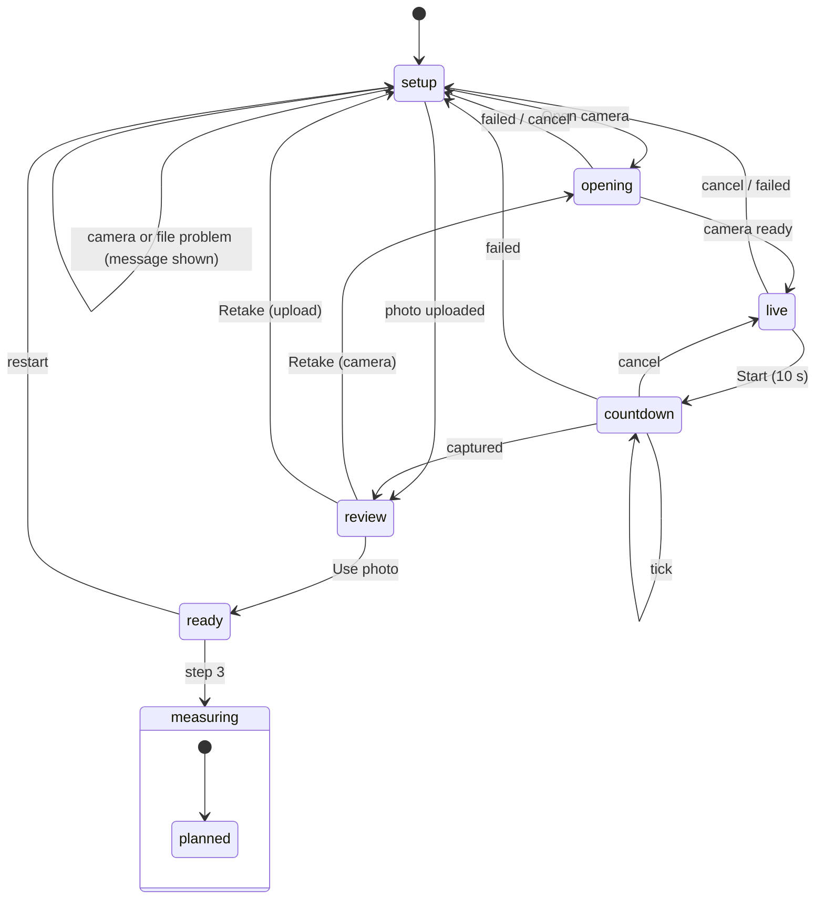

## 10. Measurement pipeline

From photo to ratio, all on the device. Only the five pixel ingredients and the method version are sent.

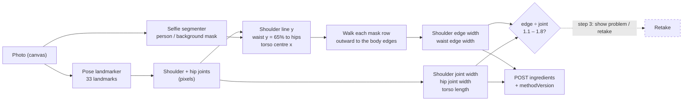

## 11. Saving a measurement

The server, not the browser, decides the user, the time, the ratio and every score.

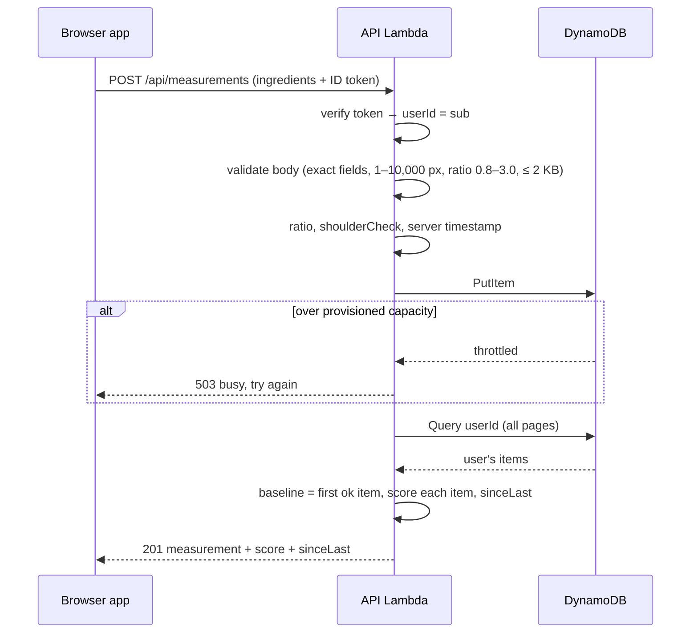

## 12. Scoring decisions

How each stored item gets its score, recomputed on every read.

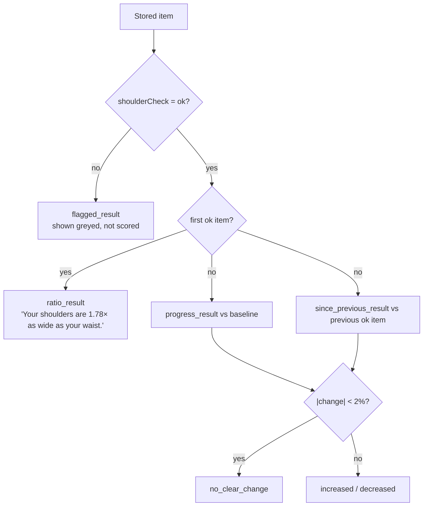

## 13. Data model

One DynamoDB item per measurement, keyed by the Cognito user's `sub` and the server's timestamp. Scores are never stored.

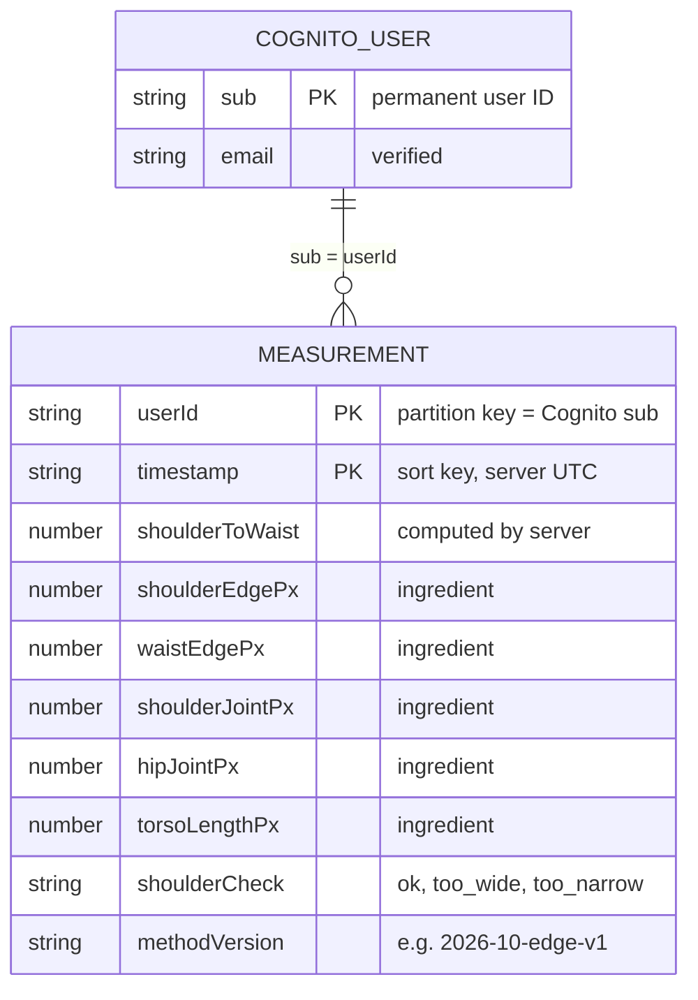

## 14. Cost guardrails

What happens when the month's bill passes $1. The kill switch only touches `Stack=app` resources; restoring service is manual.

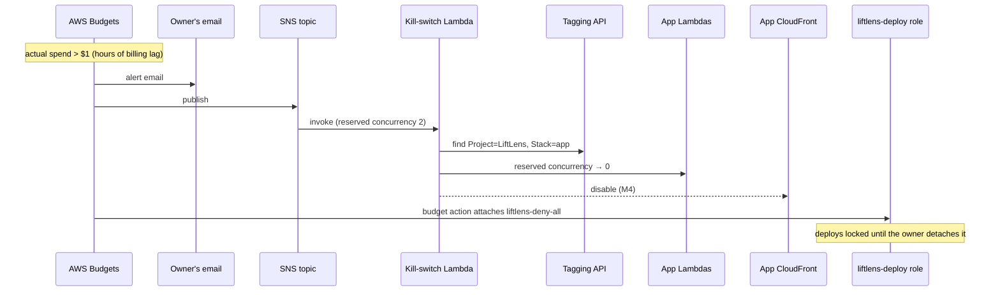

## 15. Deployment

How changes reach AWS today, and with CI/CD from M5. Every apply follows a reviewed plan.

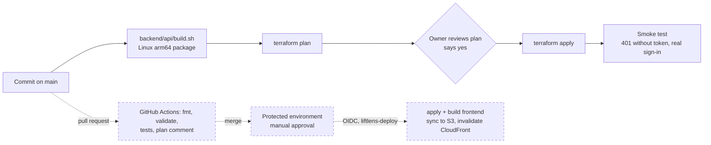
